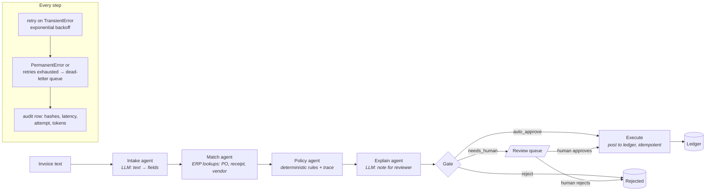

# agentic-workflow-hitl


A multi-agent invoice-approval workflow built the way production systems need to be built: LLMs read and explain, deterministic code decides, humans approve the ambiguous cases, and every step is audited.

- **Human-in-the-loop** review queue with resume: approve or reject from the CLI, the run continues.
- **Retries with backoff**, a **dead-letter queue**, and **replay** from the failed step.
- **Audit trail** in SQLite: per-step inputs, outputs, latency, attempts, tokens, and the full rule trace behind every decision.
- **Evaluation harness** with a labelled synthetic set, confusion matrix, per-scenario breakdown and failure analysis. CI fails if accuracy drops or a single invoice is auto-approved wrongly.
- **Standard library only.** No install step. Mock LLM by default, so it runs offline and the numbers are reproducible; any OpenAI-compatible endpoint for live mode.

All data is synthetic and generated by a seeded script. Nothing in this repository comes from any employer or client.

## Architecture



Two places use an LLM: reading unstructured invoice text, and writing the note a reviewer sees. Neither one makes a decision. The policy agent is ordinary code with an ordered rule list, and its output includes every rule evaluated and whether it fired, which is what an auditor asks for.

## Policy rules

Evaluated top to bottom. The first rule that fires sets the decision; the rest are still evaluated and logged, so the reviewer sees every reason at once rather than only the first one.

| # | Rule | Fires when | Outcome |
| --- | --- | --- | --- |
| 1 | `duplicate_invoice` | vendor + invoice number already posted to the ledger | **reject** |
| 2 | `vendor_inactive` | the PO's vendor is flagged inactive in the ERP | **reject** |
| 3 | `extraction_incomplete` | no total, no invoice number, or confidence < 0.5 | needs human |
| 4 | `first_invoice_from_vendor` | the vendor named on the invoice has no settled invoices on record | needs human |
| 5 | `po_missing` | no purchase order matches the quoted PO number | needs human |
| 6 | `vendor_mismatch` | the invoice vendor is not the PO vendor | needs human |
| 7 | `quantity_mismatch` | invoiced quantity exceeds goods received, or a SKU is not on the PO | needs human |
| 8 | `price_variance` | unit price is more than `price_tolerance_pct` above the PO | needs human |
| 9 | `total_vs_lines` | the stated total does not equal the sum of line items | needs human |
| 10 | `over_auto_approve_limit` | total exceeds `auto_approve_limit` | needs human |
| — | default | nothing fired | auto-approve |

**Thresholds** (`PolicyConfig` in [`agentflow/config.py`](agentflow/config.py)): `auto_approve_limit` is **150,000 INR** and `price_tolerance_pct` is **1.5%**. Both are deliberately tight. A review costs a few minutes of an AP clerk's time; a wrong auto-approval costs the invoice, and recovering it costs a great deal more than the review would have. The eval quantifies that trade-off rather than assuming it: at these thresholds the human review rate is 51.7%, and the "what I would do next" list below treats bringing that down — without giving up the zero false auto-approvals — as the actual optimisation problem. The seeded generator reads both numbers from `PolicyConfig` instead of copying them, so a threshold change cannot silently mislabel the test set; a test asserts they stay in step.

Rule 4 is the one the three-way match cannot replace. A first invoice from a newly onboarded vendor can be perfectly consistent — matching PO, matching receipt, correct prices — and still be the classic invoice-fraud setup, so it gets a human look regardless of how clean the paperwork is. Vendor history is an ERP fact (`prior_invoices`), not an inference, and a vendor record with no history field reads as zero: unknown counterparties fail toward review, not toward payment.

## Quickstart

```bash
git clone https://github.com/Ranjeetyadav47/agentic-workflow-hitl && cd agentic-workflow-hitl
python -m agentflow generate-data            # 120 labelled invoices, 14 vendors, POs, receipts
python -m agentflow run --all                # process everything; JSON logs on stderr, results on stdout
python -m agentflow review list              # what is waiting for a human
python -m agentflow review approve <RUN_ID> --note "checked GRN"
python -m agentflow show <RUN_ID>            # rule trace + per-step audit
python -m agentflow eval --compare           # scores the workflow, writes reports/eval_report.md
```

Python 3.10+. Tests: `PYTHONPATH=.:tests python -m unittest discover -s tests` (or `pytest`).

## What a run looks like

```
$ python -m agentflow show 1193648f…
run 1193648f…  invoice inv-0005  status=awaiting_review  decision=needs_human
rule trace:
  duplicate_invoice: pass
  vendor_inactive: pass
  extraction_incomplete: pass
  first_invoice_from_vendor: FIRED
  po_missing: pass
  vendor_mismatch: pass
  quantity_mismatch: pass
  price_variance: pass
  total_vs_lines: pass
  over_auto_approve_limit: pass
reviewer note: Review INV-2005 — Indigo Valve Works, 29,520.00 INR. Held because: first invoice from this vendor: no settled history on record. Before approving: confirm the vendor's onboarding record and bank details against the supplier master.
steps:
  intake   attempt=1 ok    0.15ms  tokens=181+94
  match    attempt=1 ok    0.09ms  tokens=0+0
  policy   attempt=1 ok    0.07ms  tokens=0+0
  explain  attempt=1 ok    0.10ms  tokens=334+57
```

The run stops there: `awaiting_review`, no `execute` step, nothing posted. Every rule is listed whether it fired or not, so the reviewer can see what *was* checked and found clean, not just what failed. The note names the one check that clears the rule that fired — a new-vendor flag sends the reviewer to the supplier master, not to a PO that already matches.

Logs are one JSON object per line with `run_id` on every line, so they drop straight into Cloud Logging, Datadog or `jq`.

## Evaluation

`python -m agentflow eval --compare` runs the labelled set twice, before and after a fix, and writes [`reports/eval_report.md`](reports/eval_report.md).

| Metric | before fix | after fix |
| --- | --- | --- |
| Decision accuracy | 81.7% | 100.0% |
| False auto-approvals (paid without review, wrongly) | 0 | 0 |
| Missed rejects | 4 | 0 |
| Human review rate | 70.0% | 51.7% |
| Dead-lettered runs | 0 | 0 |
| Projected LLM cost per 1,000 invoices | $0.144 | $0.133 |

**The bug the harness caught.** Indian invoices group digits in lakhs (`1,14,000.00`). The amount parser accepted Western grouping only, and on a lakh-format total it did not fail: it silently matched the suffix `14,000.00` and returned a plausible wrong number. The invoice total then disagreed with its own line items, so 18 invoices that should have auto-approved went to a human instead. Worse, four duplicates of those invoices were missed, because duplicate detection checks the ledger and the originals had never been posted. One bug, two symptoms, one of them two steps downstream. Reproduce it with `--no-indian-numbers`; the fix is `MockLLM._parse_amount`.

**What 100% means and does not mean.** The mock reads the three invoice layouts it was written for, so the after-fix score says the *workflow logic* is correct against ground truth: hard stops before soft checks, unreadable input routed to a human rather than dropped, duplicates caught, nothing auto-approved that should not be. It says nothing about extraction quality on real scans; in live mode that is the number to watch, and the harness is built so you can watch it: swap the LLM, re-run, read the failure table.

**The metric that matters.** Accuracy is the headline; *false auto-approvals* is the one with money attached. The before-fix system was wrong 18.3% of the time and still had zero of them, because the parser's failure mode made the system more cautious, not less. That is the failure mode you want, and the eval asserts it in CI.

## Human in the loop

Anything the policy agent cannot settle goes to the review queue with a plain-language note. The run is persisted as `awaiting_review` and resumes when a human acts:

```bash
python -m agentflow review list
python -m agentflow review approve <RUN_ID> --note "GRN updated, qty confirmed"   # posts to ledger as human:<note>
python -m agentflow review reject  <RUN_ID> --note "no PO raised"
```

The explain step is skipped for auto-approvals: nobody reads the note, so the system does not pay for it.

## Failure handling

| Situation | What happens |
| --- | --- |
| LLM returns 429 / 5xx / timeout | `TransientError` → retry with exponential backoff (3 attempts by default), each attempt audited |
| Retries exhausted | run → dead-letter queue, status `failed`; `dlq replay <RUN_ID>` resumes from the failed step once the cause is fixed |
| LLM returns non-JSON or a negative total | `PermanentError` → dead-letter queue immediately, no retry |
| Invoice text is unreadable (OCR garbage) | not an error: low-confidence extraction → policy routes to a human |
| Same invoice processed twice | second run is rejected as a duplicate; the ledger's unique index makes double-posting impossible even on replay |

See it happen:

```bash
AGENTFLOW_MOCK_FAIL_FIRST=2 python -m agentflow run --file invoice.txt    # two retries, then success
AGENTFLOW_MOCK_FAIL_FIRST=3 python -m agentflow run --file invoice.txt    # dead-lettered
python -m agentflow dlq list
python -m agentflow dlq replay <RUN_ID>
```

## Design decisions

- **LLMs for perception and explanation only.** Decisions with a right answer are made by code with a rule trace. This is where "eliminate hallucinated decisions" is actually solved: the model is never asked to make one.
- **Three failure classes, three handlers.** Infrastructure failures retry; model misbehaviour dead-letters; business ambiguity goes to a person. Conflating these is how systems either drop invoices or page engineers for things an AP clerk should see.
- **State in SQLite after every step.** A run can be resumed, replayed or audited from the database alone. One file, no server, and the schema is the documentation.
- **No framework.** The orchestrator is ~200 lines and the whole control flow fits on one screen. Porting to LangGraph is a mechanical mapping of steps to nodes and the gate to a conditional edge; the trade-off is checkpointing and streaming for free versus losing the ability to read every transition in one place. For a workflow with five steps, reading wins.
- **Mock by default.** The eval must be reproducible by anyone who clones the repo, with no key and no network.

## Live mode

```bash
export AGENTFLOW_LLM_MODE=live
export AGENTFLOW_LLM_BASE_URL=https://api.openai.com/v1      # or Gemini's OpenAI-compatible endpoint, Azure, Ollama, vLLM
export AGENTFLOW_LLM_API_KEY=...
export AGENTFLOW_LLM_MODEL=gpt-4o-mini
python -m agentflow run --all
```

The live client is a thin `urllib` call; HTTP 429/5xx map to `TransientError`, 4xx to `PermanentError`, so the orchestrator's retry policy applies unchanged.

## Repository layout

```
agentflow/
  orchestrator.py      state machine, retries, DLQ, HITL gate, resume/replay
  agents/              intake (LLM), matching (ERP), policy (rules), explain (LLM), execute (ledger)
  llm/                 LLMClient protocol, MockLLM, OpenAICompatibleClient
  tools/erp.py         read-only vendors / POs / receipts
  store.py             SQLite schema and queries: runs, steps, review_queue, dead_letters, ledger
  eval/harness.py      metrics, confusion matrix, failure analysis, markdown report
  data/generate.py     seeded synthetic data with ground-truth labels per scenario
  __main__.py          CLI
tests/                 44 tests: extraction, policy boundaries, reviewer notes, HITL resume, retries, DLQ, replay, eval
reports/eval_report.md generated by `eval --compare`
```

## What I would do next

1. Replace the mock with a live model on a held-out set of real-format invoices and publish the extraction accuracy honestly.
2. Export the `steps` table as OpenTelemetry spans so latency and token cost show up in the same place as everything else.
3. Batch mode with a worker pool and a per-vendor rate limit, which is where the retry policy starts to matter.
4. A second reviewer role (four-eyes above a threshold) as one more rule in the policy agent, not a new component.

## License

MIT
